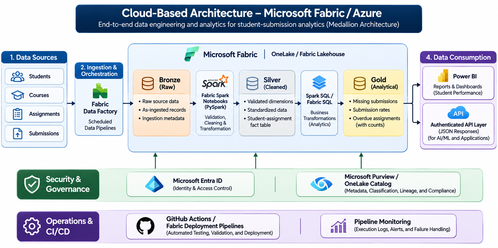
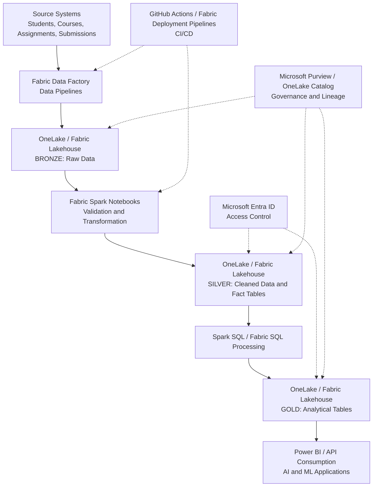
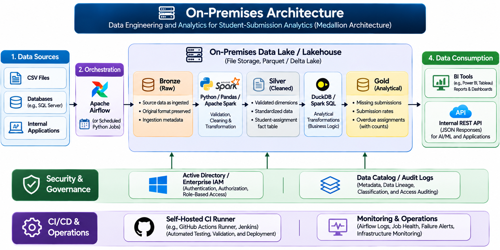
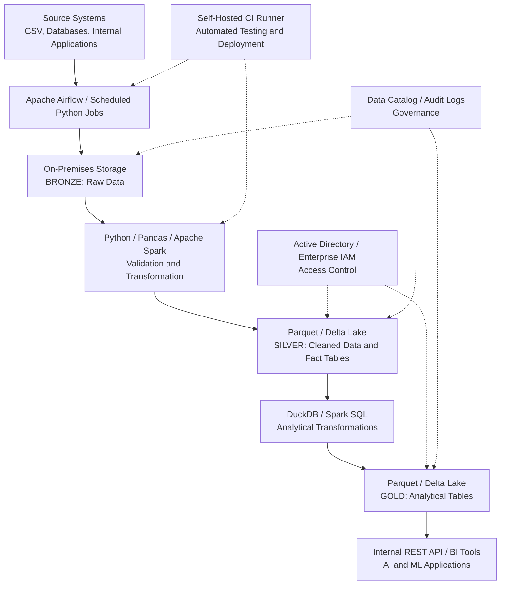

# Student Analytics Lakehouse

A Fabric-inspired **medallion architecture** (Bronze → Silver → Gold) for a
student-submission analytics pipeline, built locally with Python, Pandas,
Parquet, DuckDB SQL and Pytest. It ingests four relationally consistent source
datasets, models a student-assignment fact table, runs three analytical SQL
queries, exposes the results as API-style JSON, and includes a security /
governance bonus (PII masking, role-based access, metadata tags).

> **Scope note:** this is a *Fabric-inspired local simulation*, not a deployed
> Microsoft Fabric Lakehouse. The medallion layers, SQL analytics, governance
> controls and one-command orchestration are implemented locally with Parquet
> files and DuckDB. The section [Mapping to Microsoft Fabric](#mapping-to-microsoft-fabric)
> explains how each component maps to real Fabric / OneLake artefacts.

---

## Quick start

```bash
# 1. Create an isolated environment and install dependencies
python -m venv .venv
#   Windows:  .\.venv\Scripts\activate
#   macOS/Linux: source .venv/bin/activate
pip install -r requirements.txt

# 2. Run the whole pipeline (generate -> Bronze -> Silver -> Gold -> security)
python run_pipeline.py

# 3. Run the test suite (44 tests)
python -m pytest -q

# 4. (optional) scan for accidentally committed secrets
python scripts/check_secrets.py
```

The pipeline is fully deterministic (fixed seed `42`, fixed reference date
`2025-06-30`) so every run produces identical outputs.

---

## The data model

Four source CSVs are generated by `src/generate_data.py` into `data/source/`.

| Table | Grain | Key columns |
|-------|-------|-------------|
| `students.csv` | one per student | `student_id` (PK), name, email, program, enrollment_date, status, cohort |
| `courses.csv` | one per course | `course_id` (PK), course_name, instructor, program, start_date, end_date |
| `assignments.csv` | one per assignment | `assignment_id` (PK), course_id (FK), title, due_date, max_score |
| `submissions.csv` | one per submission | `submission_id` (PK), student_id (FK), assignment_id (FK), submission_date, score, status |

**Eligibility rule.** A student is *eligible* to submit an assignment when
their `program` matches the `program` of the course that owns the assignment.
This gives a meaningful, course-specific **eligible-student denominator**
without a separate enrolment table.

**Volumes produced (deterministic):** 50 students, 6 courses, 18 assignments,
196 submissions, and 300 eligible student-assignment pairs.

### Submission state definitions

A single, explicit taxonomy is computed in Silver and reused by the Gold SQL:

| State | Meaning |
|-------|---------|
| `on_time` | a submission row exists and `submission_date <= due_date` |
| `late` | a submission row exists and `submission_date > due_date` |
| `missing` | no submission row exists for an eligible pair |
| `overdue` | `due_date < REFERENCE_DATE` **and** state = `missing` |
| `upcoming` | `due_date >= REFERENCE_DATE` (not yet due, never overdue) |

A *late* submission was eventually handed in, so it is **not** counted as
overdue. An *upcoming* assignment cannot be overdue.

---

## Architecture

```
            students.csv  courses.csv  assignments.csv  submissions.csv
                                  |
                  +---------------v---------------+
                  |  BRONZE  (raw land + ingest meta)   data/bronze/*.parquet
                  +---------------+---------------+
                                  |
                  +---------------v---------------+
                  |  SILVER  (clean + validate + fact) data/silver/*.parquet
                  |   silver_students / courses /
                  |   assignments / submissions
                  |   silver_student_assignment_fact   <-- analytics-ready fact
                  +---------------+---------------+
                                  |  DuckDB SQL (sql/*.sql)
                  +---------------v---------------+
                  |  GOLD (analytical result tables)   data/gold/*.parquet
                  +---------------+---------------+
                                  |
                  +---------------v---------------+
                  |  API JSON  {status, message, data}  outputs/api_responses/*.json
                  +-------------------------------+
```

| Layer | Files | Purpose |
|-------|-------|---------|
| Bronze | `data/bronze/bronze_*.parquet` | Raw CSV records preserved + `_source_file`, `_ingested_at_utc` |
| Silver | `data/silver/silver_*.parquet` | Cleaned dims, validated FKs, and the `student_assignment_fact` |
| Gold | `data/gold/gold_*.parquet` | The three analytical result tables |
| API | `outputs/api_responses/*.json` | `{status, message, data}` responses |

---

## The three analytical queries

The SQL lives in `sql/` and is executed against the Silver views by DuckDB in
`src/analytics.py`. Each query also writes a Gold Parquet table.

### 1. Students missing Assignment_101  (`sql/missing_submissions.sql`)

Eligible (Data Science) students with no submission for `assignment_id = 101`.

```json
{ "status": "success",
  "message": "missing_submissions: returned 10 row(s) [reference_date=2025-06-30]",
  "data": [ { "student_id": 1001, "name": "Noor Wells", "program": "DS",
              "status": "active", "assignment_title": "Assignment_101",
              "due_date": "2025-03-15", "submission_state": "missing" }, ... ] }
```
→ **10 students**. `student_status` is included for governance/filtering
(e.g. excluding inactive students) rather than silently dropping rows.

### 2. Submission rate per course  (`sql/course_submission_rates.sql`)

Denominator = eligible student-assignment pairs that are **due** as of the
reference date (excludes upcoming). Numerator = pairs actually submitted.

| course_id | course | eligible_students | assignments_due | eligible_pairs | submitted | rate |
|-----------|--------|-------------------|-----------------|----------------|-----------|------|
| 1 | Intro to Data Science | 18 | 3 | 54 | 32 | 59.26% |
| 2 | Machine Learning Foundations | 18 | 3 | 54 | 34 | 62.96% |
| 3 | Software Architecture | 17 | 3 | 51 | 35 | 68.63% |
| 4 | Cloud Native Development | 17 | 3 | 51 | 40 | 78.43% |
| 5 | Network Security | 15 | 3 | 45 | 34 | 75.56% |
| 6 | Ethical Hacking | 15 | 2 | 30 | 21 | 70.00% |

Note course 6 has only **2** assignments due — `Assignment_603` (due
`2025-07-15`) is upcoming and correctly excluded from the denominator.

### 3. Overdue assignments per student  (`sql/overdue_assignments.sql`)

One row per student with overdue items: `overdue_count` plus the lists of
overdue assignment ids/titles. Overdue = due date passed **and** never
submitted.

```json
{ "student_id": 1012, "name": "Sofia Reed", "program": "DS",
  "overdue_count": 4,
  "overdue_assignment_ids": [102, 201, 202, 203],
  "overdue_assignment_titles": ["Assignment_102","Assignment_201",
                               "Assignment_202","Assignment_203"],
  "earliest_overdue_due": "2025-04-10" }
```
→ **41 students** have at least one overdue assignment (89 overdue pairs in
total across the population).

---

## Security & governance (bonus)

`src/security.py` demonstrates three controls that map to Fabric governance:

1. **PII masking** — emails are masked as `<first>***@<domain>` in
   `outputs/api_responses/missing_submissions_masked.json`, so the missing
   report can be shared without exposing personal addresses.
2. **Role-based access control** — `view_students(role, requester_id)`:
   - `admin` → all rows, raw PII
   - `instructor` → all rows, PII masked
   - `student` → only the requester's own row, PII masked
   Outputs: `students_view_admin.json`, `students_view_instructor.json`,
   `students_view_student.json`.
3. **Metadata tags / catalog** — `outputs/api_responses/data_catalog.json`
   records classification, PII flag, owner and tags for every Silver/Gold
   table; `gold_students_secured.parquet` additionally embeds the same tags as
   Parquet schema key-value metadata (file-level tagging).

---

## Repository layout

```
fabric-student-analytics/
├── data/
│   ├── source/        # generated CSV inputs (committed)
│   ├── bronze/        # raw Parquet (gitignored)
│   ├── silver/        # cleaned + fact Parquet (gitignored)
│   └── gold/          # analytical result Parquet (gitignored)
├── src/
│   ├── config.py          # shared constants + paths
│   ├── generate_data.py   # deterministic source data generator
│   ├── ingest.py          # Bronze layer
│   ├── transform.py       # Silver layer + fact table
│   ├── analytics.py       # Gold layer (DuckDB SQL) + JSON
│   └── security.py        # masking, RBAC, catalog (bonus)
├── sql/
│   ├── missing_submissions.sql
│   ├── course_submission_rates.sql
│   └── overdue_assignments.sql
├── outputs/api_responses/   # {status, message, data} JSON (gitignored)
├── tests/                   # 44 pytest tests
├── evidence/                # captured run logs
├── scripts/check_secrets.py
├── .github/workflows/pipeline.yml
├── run_pipeline.py          # one-command orchestration
├── requirements.txt
├── pytest.ini
├── .gitignore
├── .env.example
└── README.md
```

---

## Reproducibility

- `RANDOM_SEED = 42` and `REFERENCE_DATE = 2025-06-30` are defined once in
  `src/config.py` and used by every module, so re-running the pipeline
  reproduces identical Bronze/Silver/Gold artefacts and JSON. The idempotency
  tests (`tests/test_idempotency.py`) assert this.
- Generated layers (`bronze/`, `silver/`, `gold/`, `outputs/api_responses/`)
  are gitignored; the committed `data/source/` CSVs let reviewers inspect the
  inputs without running anything.

---

## Mapping to Microsoft Fabric

This project is a local simulation. Here is how each piece maps to a real
Fabric / OneLake implementation:

| This project | Microsoft Fabric equivalent |
|--------------|------------------------------|
| `data/source/*.csv` | Files landed in OneLake / a Data Pipeline source |
| `data/bronze/*.parquet` | **Bronze** Delta table in a Lakehouse (raw land) |
| `data/silver/*.parquet` (fact) | **Silver** Delta table (cleaned + validated) |
| DuckDB SQL over Parquet (`sql/*.sql`) | Spark SQL / Fabric SQL analytics / Warehouse |
| `data/gold/*.parquet` | **Gold** Delta table |
| `outputs/api_responses/*.json` `{status,message,data}` | Power BI dataset / REST API / Pipeline activity output |
| `run_pipeline.py` | Fabric **Data Pipeline** / notebook orchestration |
| `pytest` suite | Notebook assertions / CI validation |
| `security.py` masking | Column-level security / dynamic data masking |
| `security.py` role views | Row-level security (RLS) |
| `data_catalog.json` + Parquet tags | OneLake catalog / sensitivity labels / Microsoft Purview |
| `.github/workflows/pipeline.yml` | Fabric deployment / CI for Lakehouse artefacts |

Adapting to Fabric: replace each Parquet write with a Delta-table write from a
Lakehouse notebook, run the same SQL via the Fabric SQL endpoint, enforce RLS
via Fabric's security model, and schedule the notebook with a Data Pipeline.

---
## Deployment Architecture: Cloud vs. On-Premises

### 1. Architecture Overview

The implemented solution is a Fabric-inspired local proof of concept using Python, Pandas, Parquet, DuckDB SQL, and Pytest.

For production deployment, the same logical architecture can be implemented in either a Microsoft Fabric/Azure environment or an on-premises environment.

Both deployment models preserve the following design principles:

- **Medallion Architecture:** Separate raw, validated, and analytical data into Bronze, Silver, and Gold layers.
- **Data Quality:** Validate schema, primary keys, foreign keys, and business rules.
- **Reproducibility:** Support repeatable processing and controlled re-execution.
- **Security:** Apply role-based access, personally identifiable information (PII) protection, and metadata classification.
- **Analytics:** Provide SQL-queryable Gold datasets and API-ready JSON responses.
- **Automation:** Schedule pipeline execution, validate results, and monitor failures.

The technology choices differ by deployment environment, but the data model and business definitions remain consistent.

### 2. Cloud-Based Architecture — Microsoft Fabric / Azure

The recommended cloud architecture uses Microsoft Fabric as the primary data engineering and analytics platform.





#### Component Responsibilities

| Component | Technology | Responsibility |
|---|---|---|
| Data ingestion | Fabric Data Factory | Ingest source data through scheduled pipelines |
| Bronze storage | OneLake / Fabric Lakehouse | Preserve raw source records and ingestion metadata |
| Silver processing | Fabric Spark / PySpark | Clean, validate, standardize, and join records |
| Silver storage | Delta tables | Maintain validated dimensions and student-assignment facts |
| Gold processing | Spark SQL / Fabric SQL | Calculate missing submissions, submission rates, and overdue counts |
| Gold storage | Delta tables / Fabric Warehouse | Provide curated, queryable analytical datasets |
| Consumption | Power BI / REST API layer | Expose analytical results to reporting and AI applications |
| Identity and security | Microsoft Entra ID / Fabric permissions | Control access to data and workspaces |
| Governance | OneLake catalog / Microsoft Purview | Support metadata, classification, and lineage |
| CI/CD | GitHub Actions / Fabric deployment pipelines | Validate and promote solution artifacts |

#### Cloud Data Flow

1. Fabric Data Factory ingests student, course, assignment, and submission datasets.
2. Raw records are stored in Bronze Delta tables with ingestion metadata.
3. Fabric Spark notebooks validate schemas, keys, relationships, and assignment eligibility.
4. Cleaned records and the student-assignment fact table are written to Silver Delta tables.
5. SQL transformations generate the three required analytical datasets in Gold.
6. A downstream application or API layer retrieves Gold results and exposes consistent JSON responses.
7. Monitoring and pipeline failure alerts support operational reliability.

#### Cloud Design Considerations

**Scalability:** Fabric-managed compute and Delta tables allow processing to scale as student, assignment, and submission volumes increase.

**Reliability:** Pipeline retries, checkpointing where appropriate, idempotent transformations, and data quality checks reduce processing failures.

**Security:** Microsoft Entra ID, workspace permissions, sensitivity labels, and supported row-level or column-level controls protect data.

**Monitoring:** Fabric pipeline monitoring, execution logs, and alerting help detect failed ingestion or transformation jobs.

**Disaster recovery:** Recovery requirements should be addressed through source-data retention, versioned data, backups or replication where supported, and tested recovery procedures.

### 3. On-Premises Architecture

For organizations with data residency restrictions, limited cloud connectivity, or existing data center infrastructure, the same architecture can be deployed on-premises.

A possible production implementation uses Python or Apache Spark for processing, Apache Airflow for orchestration, and a self-managed data lake or object-storage platform.





#### Component Responsibilities

| Component | Technology | Responsibility |
|---|---|---|
| Data ingestion | Python / Airflow | Extract and schedule source data ingestion |
| Bronze storage | File server / on-premises object storage | Preserve raw data and ingestion metadata |
| Silver processing | Python / Pandas / Apache Spark | Validate, standardize, and join source records |
| Silver storage | Parquet / Delta Lake | Store validated dimensions and fact tables |
| Gold processing | DuckDB / Spark SQL | Execute business analytics |
| Gold storage | Parquet / Delta Lake | Store curated analytical outputs |
| Consumption | Internal REST API / BI platform | Provide secure downstream access |
| Security | Active Directory / enterprise IAM | Enforce authentication and role-based authorization |
| Governance | Metadata catalog / audit logging | Track classification, ownership, and processing history |
| CI/CD | GitHub Actions with self-hosted runner or internal CI | Execute tests and controlled deployments |

#### On-Premises Data Flow

1. Airflow or scheduled Python jobs ingest data from internal systems.
2. Source records are stored in a protected Bronze storage location.
3. Python or Spark validates source data and creates cleaned Silver datasets.
4. SQL transformations calculate Gold analytical results.
5. Internal services expose the results to authorized consumers.
6. Audit logs and monitoring record pipeline execution and access events.

#### On-Premises Design Considerations

**Scalability:** DuckDB and Pandas are suitable for smaller workloads. Apache Spark and distributed storage can be introduced for larger datasets.

**Reliability:** Job retries, dependency management, checkpointing where appropriate, and validation gates improve pipeline resilience.

**Security:** Enterprise identity management, network segmentation, filesystem or object-storage permissions, and application-level access controls protect student data.

**Monitoring:** Airflow logs, infrastructure monitoring, and centralized alerting can track job health and failures.

**Disaster recovery:** Backups, replicated storage, documented restoration procedures, and recovery testing are the responsibility of the infrastructure team.

### 4. Cloud vs. On-Premises Comparison

| Design Dimension | Cloud: Microsoft Fabric | On-Premises |
|---|---|---|
| Infrastructure | Managed cloud services | Organization-managed infrastructure |
| Storage | OneLake / Delta tables | File storage or object storage / Parquet / Delta |
| Processing | Fabric Spark and SQL | Python, DuckDB, or Spark |
| Orchestration | Fabric Data Factory | Airflow or scheduled jobs |
| Scaling | Managed capacity and compute configuration | Additional servers and cluster resources |
| Security | Entra ID and Fabric security features | Enterprise IAM and infrastructure controls |
| Governance | OneLake catalog / Purview | Self-managed catalog and audit systems |
| Operations | Less infrastructure administration | Greater infrastructure responsibility |
| Connectivity | Requires appropriate cloud connectivity | Can operate within internal networks |
| Cost model | Cloud capacity and service costs | Hardware, licensing, maintenance, and operations |
| Best suited for | Cloud-first analytics and integrated Microsoft ecosystems | Strict on-premises requirements and existing data center investments |

### 5. Recommended Deployment Strategy

For a cloud-first organization already using Microsoft technologies, **Microsoft Fabric is the preferred production option** because it integrates ingestion, Lakehouse storage, Spark processing, SQL analytics, and governance into a unified platform.

An **on-premises deployment** is appropriate when regulatory requirements, network isolation, or existing infrastructure constraints prevent cloud adoption.

The existing local implementation provides a technology-independent demonstration of the underlying business logic. Its modular separation of ingestion, transformation, analytics, and security allows those components to be adapted to either deployment environment.

### 6. Architecture Trade-offs and Future Enhancements

The current implementation is intentionally small, deterministic, and batch-oriented. A production solution would require additional engineering decisions:

- **Incremental ingestion:** Introduce change tracking, watermarks, or change data capture instead of full refreshes.
- **Data contracts:** Define versioned schemas and policies for handling unexpected source changes.
- **Data quality:** Add configurable validation thresholds, quarantine handling, and alerting.
- **Historical analytics:** Decide whether changing student attributes require slowly changing dimensions.
- **Observability:** Track pipeline duration, freshness, row counts, failures, and data quality metrics.
- **Security:** Move from simulated role-based views to enforced platform permissions and audited access.
- **API serving:** Deploy an authenticated API service with pagination, caching, and appropriate rate limits.
- **Recovery:** Define recovery point and recovery time objectives and test restoration procedures.

These are proposed production enhancements and are not claimed to be implemented in the local proof of concept.

### 7. Design Walkthrough Summary

The architectural decision is to **separate logical data modeling from physical infrastructure**.

Bronze preserves the source data, Silver establishes validated relationships and consistent business rules, and Gold provides curated analytical results. The same definitions for missing submissions, submission rates, and overdue assignments are maintained across both deployment options.

The local implementation validates the approach; the cloud and on-premises architectures describe how it can be operationalized at enterprise scale.

---

## Deliverables checklist

| Requirement | Implementation |
|-------------|---------------|
| Four input datasets | `data/source/*.csv` (deterministic) |
| Lakehouse-like storage | Bronze/Silver/Gold Parquet directories |
| Student-submission joins | `silver_student_assignment_fact` |
| Students missing Assignment_101 | `sql/missing_submissions.sql` → 10 rows |
| Submission rate per course | `sql/course_submission_rates.sql` (eligible-student denominator) |
| Overdue assignments per student | `sql/overdue_assignments.sql` (explicit due-date logic) |
| API-ready output | `outputs/api_responses/*.json` `{status, message, data}` |
| Automated orchestration | `python run_pipeline.py` |
| Validation | `python -m pytest` (44 tests) |
| CI/CD | `.github/workflows/pipeline.yml` |
| Security bonus | PII masking, RBAC, metadata tags (`src/security.py`) |
| Submission | Public GitHub repository + README + evidence |

---

## Testing

```bash
python -m pytest -q
```

44 tests across five files assert pipeline structure, schema & referential
integrity, business-logic counts, API response shape/content, idempotency, and
the security layer. See `evidence/pytest_results.txt` for a captured run.
